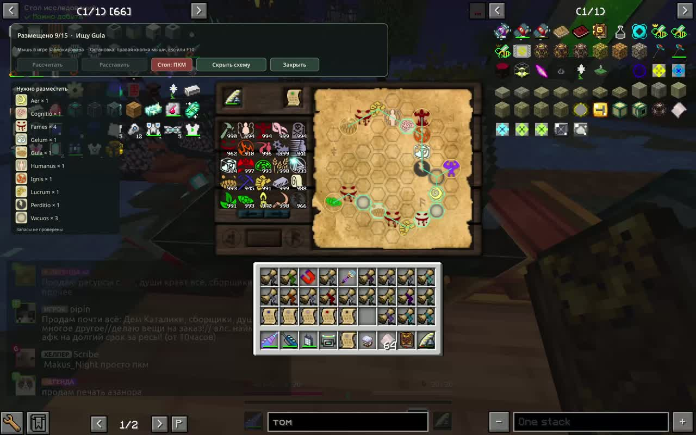

# Thaumcraft Aspects Overlay

**English** · [Русский](README.ru.md)

A Thaumcraft 4 research solver and auto-placement overlay for Minecraft: recognize a research note, connect its aspects, and place the solution with one click.

Решатель исследований Таумкрафт 4: распознавание поля, соединение аспектов и автоматическая расстановка для Minecraft 1.7.10.

> **Built for one particular setup, not tested as a universal tool.** The working configuration is **LoliLand Techno Magic RPG, Minecraft 1.7.10, Thaumcraft 4.2.3.5, PortProton/Wine inside Gamescope, Fedora GNOME Wayland**. Other launchers, distributions, resource packs and display scales need their own verification. Settings help adapt the application; they do not provide a Windows/macOS automation backend.

## Demo

[](docs/media/demo.mp4)

[Watch / download the 47-second MP4](docs/media/demo.mp4). Recorded on the configuration above; the recording shows an earlier panel with separate solve/place buttons. The current panel also has **Решить и расставить** (Solve and place).

## Features

- Capture the Minecraft window, recognize the hex grid and existing aspects, then calculate a connecting scheme.
- Minimize the number of added cells. `optimal` means the minimum was proved; `feasible` means a valid solution was found before the time budget expired, without a proof of minimality.
- **One button** to capture, solve and place; separate calculation and placement controls remain available.
- Search and scroll the aspect palette automatically; check the board before each drag and confirm every placed aspect from a new frame.
- Handle animated links, overlapping glyphs, translucent Spiritus, Avaritia Terminus (`Lucrum + Alienis`) and the changing colour of Alfheim Tincturem (`Lux + Ordo`).
- Isolate physical mouse input inside the nested game while placing. The desktop mouse remains usable; right-click inside the game stops the bot.
- Read textures from your locally installed mods. No game textures, JARs, accounts or launch tokens are included; the application itself needs no network after dependency installation.

This is an external Python application, not a Minecraft mod. The current in-game interface and most runtime messages are in Russian; the controls are translated below.

## Compatibility

| Environment | Status |
| --- | --- |
| The Fedora / PortProton / Gamescope setup above | Live capture, overlay and auto-placement verified |
| Other Linux distributions and Minecraft launchers in Gamescope | Configurable, not live-tested; the nested server must expose `GAMESCOPE_PID` and `xwayland-*` pointer devices |
| Linux X11 without Gamescope | Capture/calculation path exists; unverified on a separate setup; automatic placement refuses to grab the desktop mouse |
| Wayland game without an accessible X11 window | No live capture backend |
| Windows / macOS | No live overlay or auto-placement backend; offline image mode avoids Linux/X11 imports but remains untested on these systems |
| Other Thaumcraft versions / modified textures | Unsupported; the loader requires Thaumcraft 4.2.3.5 |

## Quick start: Linux

1. Install Git, [uv](https://docs.astral.sh/uv/getting-started/installation/), [Gamescope](https://github.com/ValveSoftware/gamescope) and the system libraries for [Qt's X11/xcb plugin](https://doc.qt.io/qt-6/linux-requirements.html). Python **3.12–3.14** is required; `uv` can manage Python for the project.
2. Clone and prepare the project:

   ```bash
   git clone https://github.com/DefaultPerson/thaumcraft-aspects-overlay.git
   cd thaumcraft-aspects-overlay
   uv sync --frozen
   cp config.example.toml config.toml
   ```

3. Start Minecraft in Gamescope using your launcher's Gamescope integration, then open the research table with an unfinished note. The overlay must have access to the same user's X11 server and local `mods/` directory.
4. Check detection and start:

   ```bash
   ./run.sh --diagnose
   ./run.sh
   ```

5. Click **Решить и расставить**. When finished, collect the research note yourself.

`run.sh` changes to the project directory and synchronizes the locked runtime dependencies. For an already prepared, offline environment, run `.venv/bin/python -m aspects_overlay` from that directory instead.

Optional application-menu shortcut: run `./install-desktop.sh`. It installs or updates this checkout's launcher for the current user without starting the application or enabling autostart. Run it again if you move the checkout. `launch.sh` writes startup diagnostics to `.runtime/launcher.log`.

## Configure your instance

Edit the ignored `config.toml`, copied from [config.example.toml](config.example.toml). The defaults use automatic detection, an 8-second solver budget and `.runtime/` for private results.

```toml
# Uncomment and set your own instance directory if autodetection fails:
# game_dir = "~/Games/MyMinecraftInstance"
# display = ":2"
timeout = 8.0
output = ".runtime"
exclude = []
# inventory = "inventory.json"
# window_id = "0xe00003"
```

- `game_dir`: the instance directory **containing `mods/`**, not the launcher installation or a JAR file. `~` expands to your home directory. Paths written in TOML are relative to that configuration file.
- `display`: the game's X11 display, which can differ from the desktop's display. Use the value reported by `--diagnose`; the `:2` example is not a universal default.
- `window_id`: optional decimal/hex string for an explicit X11 window; requires both `display` and `game_dir`. Use only when discovery fails or multiple windows share a display. On the correct display, `xwininfo` can identify a window. IDs change when Minecraft restarts.
- `timeout`: solver budget, **0.25–60 seconds**. Recognition retries are separate: up to 5 seconds per stage. Auto-placement has a 180-second total limit.
- `exclude`: aspect IDs that may not be added. Existing anchors stay on the board.
- `inventory`: optional JSON file such as `{"aer": 10, "lux": 5}`. Omitted aspects count as zero. Without this file, stock is **not checked**; shortages can stop placement.
- `output`: private logs, screenshots and JSON reports. Keep it out of version control.

CLI options override TOML. `config.toml` is read from the current working directory; `run.sh` uses the project directory. Select a different profile with `--config /path/to/profile.toml`. CLI relative paths use the working directory. Examples:

```bash
./run.sh --game-dir "$HOME/Games/MyMinecraftInstance" --display :2
./run.sh --config config.local-second-instance.toml --timeout 20
./run.sh --exclude tempestas,alienis
./run.sh --inventory inventory.json
```

Geometry is derived from the captured game window and parchment, rather than fixed screen coordinates. The verified configuration uses a **1920×1200** game window and **2880×1800** Gamescope output; other sizes and scaling settings still need testing. Standard aspect artwork and a grid radius of at most 4 are required.

## Buttons and cancellation

| In-game button | Action |
| --- | --- |
| Решить и расставить | Capture the current note, solve and place automatically |
| Рассчитать | Calculate a fresh scheme for manual placement |
| Расставить | Place the calculated scheme |
| Стоп | Cancel recognition, a queued run or placement; an active solver returns within its budget and its cancelled result is discarded |
| Скрыть схему / Показать схему | Hide/show the scheme; keep the button panel visible |
| Закрыть | Close the overlay and release input |

Cyan cells show additions; gold rings mark existing aspects. Aspect costs appear at the left. Grey buttons are currently unavailable. Optional shortcuts: **F8** calculate, **F9** toggle scheme, **F10** place/stop, **Esc** cancel/stop, **Ctrl+Alt+Q** close. Buttons still work if global shortcuts are unavailable.

During placement, movement, clicks and scrolling from the physical mouse inside Minecraft are blocked. **Right-click inside the game** to stop; the click is consumed. Input is released on completion, cancellation, an error or connection closure. The bot sends addressed events to the game window, so you can use other desktop applications. Keep the research table open and Gamescope visible; switch applications rather than minimizing it. The internal game focus must stay on Minecraft.

After a stopped attempt, click **Решить и расставить** again: already placed aspects are read afresh. No separate control window is opened. Placement spends aspect points and ink; the application does not craft missing aspects, refill ink or collect completed notes.

## Offline screenshot mode

Solve a PNG without opening an overlay or connecting to X11:

```bash
uv run --frozen python -m aspects_overlay --image note.png --game-dir /path/to/instance --output .runtime
```

On Windows, use a Windows path such as `"C:/Games/MyMinecraftInstance"`; do not use the shell scripts. This mode writes `.runtime/solution.json` with axial `q,r` coordinates and aspect IDs. It does not click or draw over a running game. Linux is verified; Windows/macOS execution has not been tested.

## Recognition and troubleshooting

- Open an unobstructed research note and move tooltips away. Startup requires two consecutive agreeing whole-board readings. Weak matches need shape/colour checks and temporal confirmation; cells from different frames are never combined.
- Unchanged pixel crops may reuse recognition results. Changed cells, grid connectivity and aspect relationships are checked again. Known neighbouring glyphs are masked when checking overlap; heavily obscured or unknown coloured glyphs stop the run.
- A temporary animation or uncertain reading is retried automatically for up to 5 seconds before solving, before dragging and while confirming a placement. Do not repeatedly click. An unconfirmed drag is never blindly repeated.
- If a note changes or closes, the old scheme is invalidated. A fully placed scheme is distinguished from native Minecraft confirmation of research completion.
- Missing aspect? Check stock and exclusions. A server-specific aspect needs a verified recipe and local artwork added to `aspects_overlay/data/aspects.json`; arbitrary add-on aspects are not automatically supported.
- No window found? Run `--diagnose`, check the instance path and display, then use explicit `--window-id` if needed. Qt/xcb startup errors require the matching system libraries, not changes to aspect recipes.
- `.runtime/overlay.log`, `launcher.log`, `last-solution.json`, `last-placement.json` and `last-placement.png` contain local diagnostics. Review them before sharing: screenshots can contain game chat or player names. The bundled demonstration is an explicitly selected gameplay recording; diagnostic captures are excluded from Git.

## Development and checks

```bash
uv sync --frozen
uv run --frozen pytest -q
```

Public tests exercise the solver, controls, cancellation and configuration. Tests using proprietary game artwork or private live captures are skipped unless their `ASPECTS_*` environment variables are provided; see the test files for each fixture. A public test pass does not demonstrate live compatibility with another machine. Live verification on the author's setup included Tincturem recognition and successful completion of an 11-placement note.

## Attribution

Aspect relationships and base colours are adapted from [exaltedo2/ThaumcraftResearcher](https://github.com/exaltedo2/ThaumcraftResearcher), commit `3573b36c1a0e18b8159f974a46d0b61f8284f3f4`, under MIT; see [source provenance](third_party/ThaumcraftResearcher/SOURCE) and [upstream license](third_party/ThaumcraftResearcher/LICENSE). Add-on recipes were checked against the installed mods. Minecraft, Thaumcraft and add-on artwork belong to their respective authors and are read locally, not redistributed as texture files. The demo shows in-game footage. This project is not affiliated with Mojang, Thaumcraft or LoliLand.
