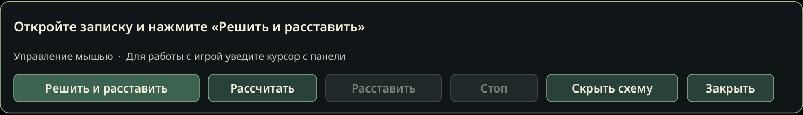
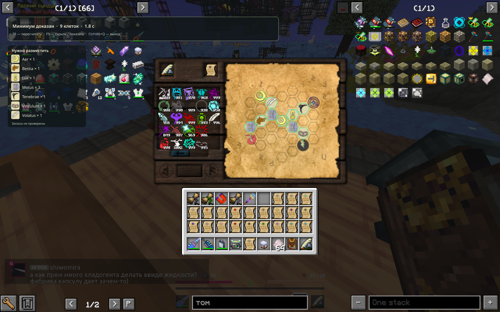
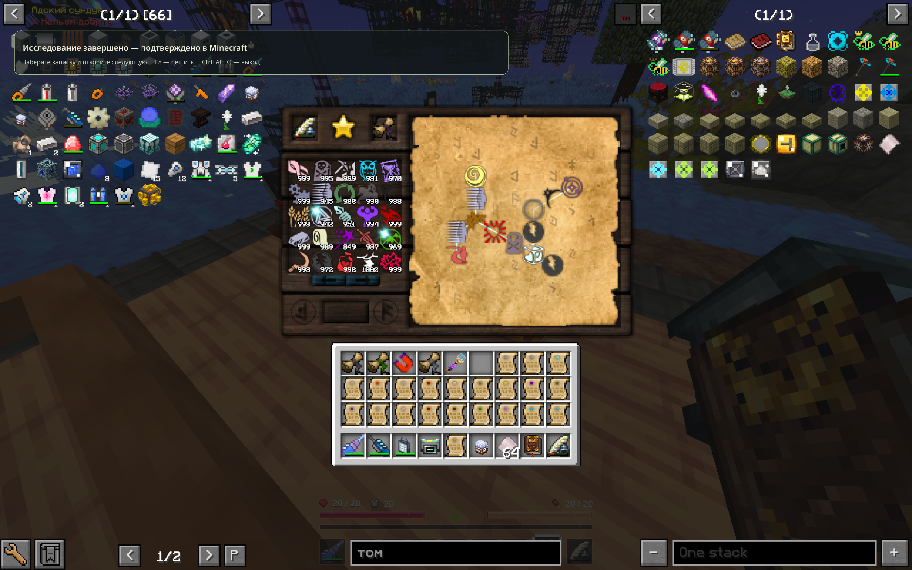

# Thaumcraft Aspects Overlay

[English](README.md) · **Русский**

Распознавание исследований Таумкрафт 4, расчёт цепочек и автоматическая расстановка аспектов одной кнопкой.

> Собрано под **LoliLand Techno Magic RPG, Minecraft 1.7.10, Thaumcraft 4.2.3.5, PortProton/Wine + Gamescope, Fedora GNOME Wayland**. Другие конфигурации требуют проверки. Авторасстановка работает через Linux/Gamescope; для Windows/macOS есть только непроверенный режим обработки снимка.

## Демонстрация

https://github.com/user-attachments/assets/b5475065-a7db-4835-a4f7-c1a805c0d7db

45 секунд, 7,2 МБ. В ролике более ранняя панель; сейчас добавлена общая кнопка **«Решить и расставить»**.

## Быстрый запуск

Установить Git, [uv](https://docs.astral.sh/uv/getting-started/installation/), [Gamescope](https://github.com/ValveSoftware/gamescope) и [библиотеки Qt X11/xcb](https://doc.qt.io/qt-6/linux-requirements.html). Нужны Python 3.12–3.14 и обычные текстуры модов.

```bash
git clone https://github.com/DefaultPerson/thaumcraft-aspects-overlay.git
cd thaumcraft-aspects-overlay
uv sync --frozen
cp config.example.toml config.toml
./run.sh --diagnose
./run.sh
```

Перед последними двумя командами открыть Minecraft в Gamescope и незавершённую записку. Нажать **«Решить и расставить»**; готовую записку забрать самостоятельно. Интерфейс на русском.

- Бот ищет аспекты в списке, расставляет их и проверяет каждую клетку. **Правая кнопка внутри игры останавливает бота.** На рабочем столе мышь остаётся доступной.
- Держать стол открытым и Gamescope видимым. После остановки снова нажать **«Решить и расставить»**, чтобы учесть уже поставленные аспекты.
- Расходуются очки аспектов и чернила; запасы не проверяются, пока не задан файл инвентаря.

В [config.toml](config.example.toml) настроить путь к сборке, дисплей, лимит поиска и исключения. Ярлык в меню приложений: `./install-desktop.sh`.

[Подробное руководство](docs/guide.ru.md): совместимость, настройки, управление, режим снимка, распознавание, диагностика и тесты.

## Скриншоты

<details>
<summary>Управление, схема решения и готовое исследование</summary>

Актуальная панель с общей кнопкой:



Схема решения и расход аспектов:



Завершение, подтверждённое Minecraft:



На последних двух снимках более ранняя панель. Все три сняты во время реальных запусков.

</details>

## Источники

Данные аспектов адаптированы из [ThaumcraftResearcher](https://github.com/exaltedo2/ThaumcraftResearcher); сохранены [лицензия MIT](third_party/ThaumcraftResearcher/LICENSE) и [происхождение данных](third_party/ThaumcraftResearcher/SOURCE). Игровые текстуры читаются локально и не включены в репозиторий. Проект не связан с Mojang, авторами Thaumcraft или LoliLand.
