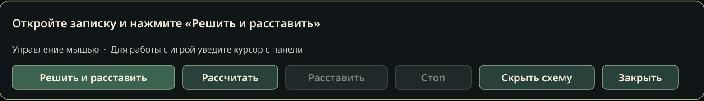
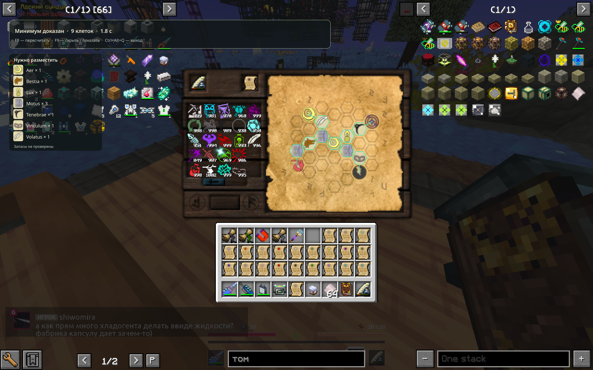
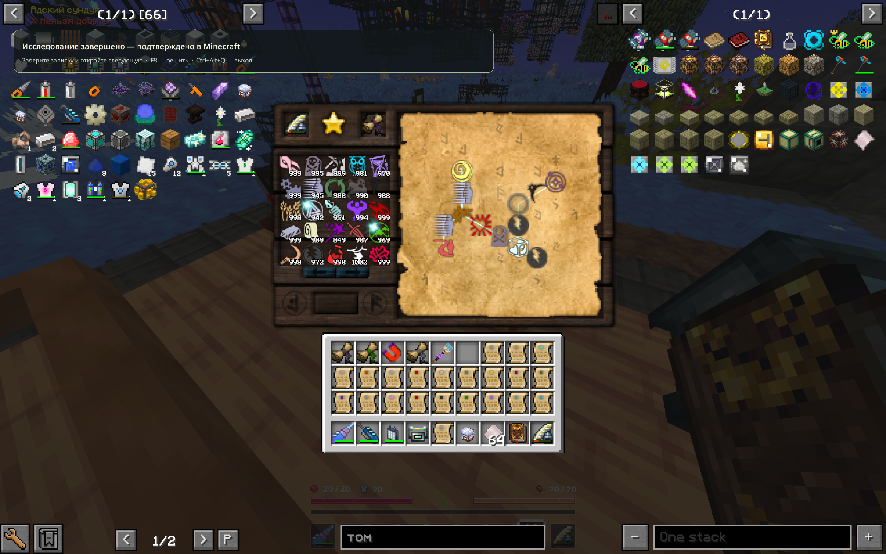

# Подробное руководство

[Краткий README](../README.ru.md) · [English](guide.md)

Команды выполнять из корня проекта.

> **Программа собрана под конкретную конфигурацию автора и не проверена как универсальный инструмент.** Рабочая связка: **LoliLand Techno Magic RPG, Minecraft 1.7.10, Thaumcraft 4.2.3.5, PortProton/Wine внутри Gamescope, Fedora GNOME Wayland**. Другие лаунчеры, дистрибутивы, ресурспаки и масштабы требуют отдельной проверки. Настройки помогают адаптировать запуск, но не добавляют автоматизацию для Windows/macOS.

## Возможности

- Захват окна Minecraft, распознавание шестиугольной сетки и стоящих аспектов, расчёт соединяющей их схемы.
- Минимизация числа добавленных клеток. `optimal` означает доказанный минимум; `feasible` — допустимое решение в пределах лимита без доказательства минимальности.
- **Одна кнопка** для захвата, расчёта и расстановки; отдельные кнопки расчёта и заполнения сохранены.
- Автоматический поиск и прокрутка списка аспектов, проверка поля перед каждым перетаскиванием и подтверждение каждой поставленной клетки новым снимком.
- Обработка анимации связей, перекрывающихся значков, полупрозрачного Spiritus, Terminus из Avaritia (`Lucrum + Alienis`) и меняющего цвет Tincturem из Alfheim (`Lux + Ordo`).
- Блокировка физической мыши внутри вложенного игрового окна на время расстановки. На рабочем столе мышь доступна; правая кнопка внутри игры останавливает бота.
- Текстуры читаются из установленных модов. В репозитории нет игровых текстур, JAR, аккаунтов или токенов лаунчера; после установки зависимостей самой программе сеть не нужна.

Это отдельное приложение на Python, а не мод Minecraft. Интерфейс оверлея и большинство сообщений программы — на русском.

## Скриншоты

**Управление одной кнопкой.** Актуальная панель объединяет захват, расчёт и заполнение в **«Решить и расставить»**; отдельно доступны расчёт, остановка и скрытие схемы.



**Схема решения и расход аспектов.** Бирюзовые контуры показывают добавления, слева перечислены нужные аспекты. В этом примере доказан минимум из девяти добавленных клеток.



**Завершение подтверждено Minecraft.** Видны готовая записка, золотая кнопка копирования и сообщение оверлея об успешном завершении.



Это сохранённые снимки реальных запусков. Схема и завершение сняты на более ранней версии панели; актуальные кнопки показаны на первом снимке. Нажмите на изображение, чтобы открыть его в полном разрешении.

## Совместимость

| Среда | Статус |
| --- | --- |
| Указанная выше связка Fedora / PortProton / Gamescope | Захват, оверлей и расстановка проверены в игре |
| Другие Linux-дистрибутивы и лаунчеры внутри Gamescope | Можно настроить, но отдельно не проверено; вложенный сервер должен предоставлять `GAMESCOPE_PID` и устройства мыши `xwayland-*` |
| Linux X11 без Gamescope | Есть путь захвата/расчёта, на отдельной конфигурации не проверен; автоматическая расстановка отказывается блокировать мышь рабочего стола |
| Игра под Wayland без доступного окна X11 | Захват в реальном времени не реализован |
| Windows / macOS | Живого оверлея и автокликов нет; режим снимка не импортирует Linux/X11-компоненты, но на этих ОС не проверен |
| Другие версии Thaumcraft / изменённые текстуры | Не поддерживаются; загрузчик требует Thaumcraft 4.2.3.5 |

## Быстрый запуск: Linux

1. Установить Git, [uv](https://docs.astral.sh/uv/getting-started/installation/), [Gamescope](https://github.com/ValveSoftware/gamescope) и системные библиотеки [плагина Qt X11/xcb](https://doc.qt.io/qt-6/linux-requirements.html). Нужен Python **3.12–3.14**; `uv` умеет управлять версией Python для проекта.
2. Скачать и подготовить проект:

   ```bash
   git clone https://github.com/DefaultPerson/thaumcraft-aspects-overlay.git
   cd thaumcraft-aspects-overlay
   uv sync --frozen
   cp config.example.toml config.toml
   ```

3. Запустить Minecraft внутри Gamescope через соответствующие настройки своего лаунчера. Открыть стол исследований с незавершённой запиской. Оверлею нужен доступ к X11-серверу того же пользователя и локальной папке `mods/`.
4. Проверить определение игры и запустить:

   ```bash
   ./run.sh --diagnose
   ./run.sh
   ```

5. Нажать **«Решить и расставить»**. Готовую записку забрать самостоятельно.

`run.sh` переходит в каталог проекта и синхронизирует зависимости по lock-файлу. Для уже подготовленного окружения без обращения к сети запускать `.venv/bin/python -m aspects_overlay` из этого каталога.

Ярлык в меню приложений устанавливается командой `./install-desktop.sh`. Она создаёт или обновляет ярлык текущей копии проекта для текущего пользователя, не запускает приложение и не включает автозапуск. После переноса каталога повторить команду. `launch.sh` сохраняет диагностику запуска в `.runtime/launcher.log`.

## Настройка своей сборки

Скопировать [config.example.toml](../config.example.toml) в игнорируемый Git файл `config.toml` и отредактировать. По умолчанию используются автоопределение, лимит поиска 8 секунд и папка `.runtime/` для приватных результатов.

```toml
# При ошибке автоопределения раскомментируйте и укажите свою папку сборки:
# game_dir = "~/Games/MyMinecraftInstance"
# display = ":2"
timeout = 8.0
output = ".runtime"
exclude = []
# inventory = "inventory.json"
# window_id = "0xe00003"
```

- `game_dir` — папка сборки, **внутри которой находится `mods/`**, а не каталог лаунчера или JAR. `~` означает домашнюю папку. Пути в TOML считаются относительно самого файла настроек.
- `display` — X11-дисплей игры; он может отличаться от дисплея рабочего стола. Ориентироваться на `--diagnose`; `:2` в примере не является универсальным значением.
- `window_id` — необязательный ID конкретного окна X11 в десятичной или шестнадцатеричной строке. Требует `display` и `game_dir`. Нужен при сбое автоопределения или нескольких окнах на одном дисплее. Для определения ID можно использовать `xwininfo` на нужном дисплее. После перезапуска Minecraft ID меняется.
- `timeout` — лимит решателя, **0.25–60 секунд**. Повторы распознавания имеют отдельный лимит до 5 секунд на этап; общий лимит расстановки — 180 секунд.
- `exclude` — ID аспектов, которые запрещено добавлять. Исходные аспекты остаются на поле.
- `inventory` — необязательный JSON, например `{"aer": 10, "lux": 5}`. Неуказанные аспекты считаются отсутствующими. Без файла запасы **не проверяются**; нехватка может остановить расстановку.
- `output` — приватные журналы, снимки и JSON-отчёты. Не добавлять этот каталог в Git.

Параметры командной строки имеют приоритет над TOML. `config.toml` читается из рабочего каталога; `run.sh` использует каталог проекта. Другой профиль выбирается через `--config /путь/к/профилю.toml`. Относительные пути командной строки считаются от рабочего каталога. Примеры:

```bash
./run.sh --game-dir "$HOME/Games/MyMinecraftInstance" --display :2
./run.sh --config config.local-second-instance.toml --timeout 20
./run.sh --exclude tempestas,alienis
./run.sh --inventory inventory.json
```

Геометрия вычисляется по окну игры и пергаменту, а не по фиксированным координатам экрана. Проверены внутреннее окно **1920×1200** и вывод Gamescope **2880×1800**; другие размеры и масштабы требуют тестирования. Нужны обычные текстуры аспектов и сетка радиуса не больше 4.

## Кнопки и остановка

| Кнопка | Действие |
| --- | --- |
| Решить и расставить | Новый снимок текущей записки, расчёт и автоматическое заполнение |
| Рассчитать | Новая схема для ручной расстановки |
| Расставить | Заполнение рассчитанной схемы |
| Стоп | Отмена распознавания, ожидающего запуска или расстановки; уже работающий решатель завершится в пределах лимита, отменённый результат не используется |
| Скрыть схему / Показать схему | Переключение подсказок с сохранением панели кнопок |
| Закрыть | Завершение оверлея и освобождение управления |

Бирюзовые клетки — добавления, золотые круги — исходные аспекты, слева указан расход. Серые кнопки недоступны. Дополнительные сочетания: **F8** — расчёт, **F9** — схема, **F10** — расстановка/остановка, **Esc** — отмена/остановка, **Ctrl+Alt+Q** — выход. Кнопки работают и при недоступных глобальных сочетаниях.

Во время расстановки физические движения, щелчки и прокрутка внутри Minecraft блокируются. **Правая кнопка мыши внутри игры** останавливает бота; этот щелчок в игру не передаётся. Управление возвращается после завершения, отмены, ошибки или закрытия соединения. Бот направляет события в окно игры, поэтому на рабочем столе можно пользоваться другими приложениями. Держать стол открытым, Gamescope — видимым; переключаться между приложениями, не сворачивая его. Внутренний фокус должен оставаться у Minecraft.

После остановки снова нажать **«Решить и расставить»**: уже поставленные аспекты учитываются заново. Дополнительное окно управления не открывается. Расстановка расходует очки аспектов и чернила; приложение не создаёт недостающие аспекты, не пополняет чернила и не забирает готовые записки.

## Решение по снимку

Обработать PNG без окна оверлея и подключения к X11:

```bash
uv run --frozen python -m aspects_overlay --image note.png --game-dir /путь/к/сборке --output .runtime
```

В Windows указать путь вида `"C:/Games/MyMinecraftInstance"`; shell-скрипты не использовать. Результат — `.runtime/solution.json` с осевыми координатами `q,r` и ID аспектов. Этот режим не кликает и не рисует поверх игры. Выполнение проверено на Linux; Windows/macOS не проверены.

## Распознавание и диагностика

- Открыть не перекрытую подсказками записку. Перед запуском нужны два последовательных совпадающих прочтения всего поля. Слабые совпадения проходят проверку формы/цвета и повторное подтверждение; клетки разных кадров не склеиваются.
- Для полностью совпадающих пикселей используется кэш. Изменённые клетки, связность сетки и связи аспектов проверяются заново. При перекрытии учитывается маска известных соседей; сильное перекрытие и неизвестный цветной значок останавливают процесс.
- Анимация или неуверенное распознавание автоматически повторяются до 5 секунд перед расчётом, перетаскиванием и подтверждением размещения. Многократно нажимать кнопку не нужно. Неподтверждённое перетаскивание не повторяется вслепую.
- При замене записки или закрытии поля старая схема сбрасывается. Размещение всей схемы отличается от подтверждения готовности исследования самой игрой.
- Не найден аспект? Проверить запасы и исключения. Для нового серверного аспекта нужны проверенный рецепт и локальная текстура в `aspects_overlay/data/aspects.json`; произвольные аспекты аддонов автоматически не поддерживаются.
- Не найдено окно? Запустить `--diagnose`, проверить каталог сборки и дисплей, при необходимости задать `--window-id`. Ошибки запуска Qt/xcb требуют системных библиотек, а не изменения рецептов аспектов.
- `.runtime/overlay.log`, `launcher.log`, `last-solution.json`, `last-placement.json` и `last-placement.png` содержат локальную диагностику. Проверять перед отправкой: в снимках могут быть игровой чат и имена игроков. Демонстрационный ролик и снимки галереи выбраны для публикации отдельно; остальные диагностические снимки исключены из Git.

## Разработка и проверки

```bash
uv sync --frozen
uv run --frozen pytest -q
```

Публичные тесты проверяют решатель, управление, отмену и настройки. Проверки с игровыми текстурами и приватными снимками пропускаются, пока не заданы соответствующие переменные `ASPECTS_*`; нужные фикстуры перечислены в тестах. Прохождение публичных тестов не доказывает совместимость с другой машиной. На конфигурации автора проверены распознавание Tincturem и успешное завершение записки с 11 добавлениями.

## Источники

Связи аспектов и базовые цвета адаптированы из [exaltedo2/ThaumcraftResearcher](https://github.com/exaltedo2/ThaumcraftResearcher), commit `3573b36c1a0e18b8159f974a46d0b61f8284f3f4`, MIT; см. [происхождение данных](../third_party/ThaumcraftResearcher/SOURCE) и [лицензию источника](../third_party/ThaumcraftResearcher/LICENSE). Рецепты дополнительных аспектов проверены по установленным модам. Minecraft, Thaumcraft и текстуры аддонов принадлежат соответствующим авторам и читаются локально; файлы текстур не распространяются. Демонстрация содержит запись игры. Проект не связан с Mojang, авторами Thaumcraft или LoliLand.
